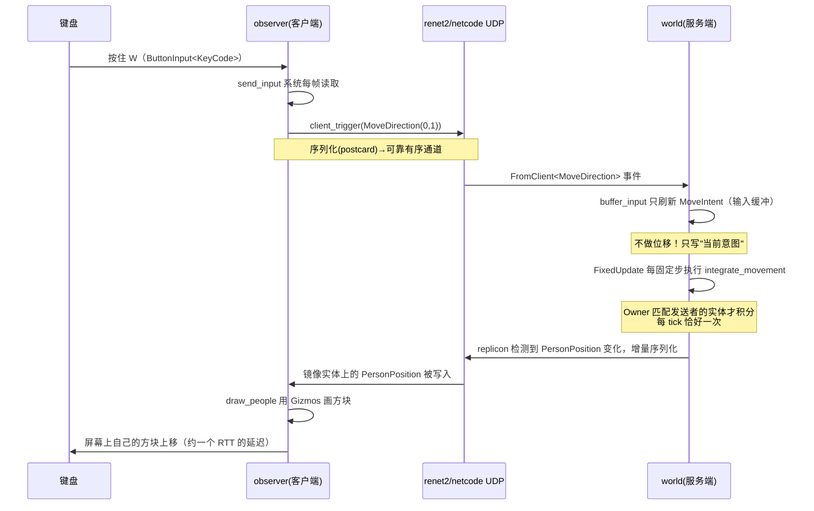

# bevy_replicon 教学示例：三人行

浏览器监控面板 `touchpad`（WASM / WebTransport）：启动 world 时增加
`--webtransport --advertise-ip 127.0.0.1`，随后在 `touchpad/` 执行
`trunk serve`。地图、移动状态、归属和连接人数会实时同步；面板不占用人物。
局域网 HTTPS、证书与构建步骤见 [touchpad/README.md](touchpad/README.md)。

一个最小的**服务端权威（server-authoritative）**多人示例，用于理解 Bevy 的
实体 / 组件 / 系统 / 观察者 / 消息（事件）如何在一个真实的网络需求下组织。

| crate | 角色 | 进程形态 | 职责 |
|---|---|---|---|
| `base` | 共享协议库 | 不运行 | 定义人物、位置、监控数据与输入消息，统一注册复制规则与网络事件 |
| `world` | 服务端 | 无窗口 headless | 创建实体、分配归属、接收输入到缓冲、**唯一**有权修改位置、把变化同步出去 |
| `observer` | 客户端 | 带窗口 | 连接服务端、镜像实体、每帧上报键盘输入、用 Gizmos 画出实体 |
| `touchpad` | 监控面板 | 浏览器 WASM | WebTransport 连接、地图与监控数据、鼠标与触摸导航 |

## 版本栈（重要）

```text
bevy                    0.19.1
bevy_replicon           0.41.1     ← 由 renet2 后端的版本链决定，见下
bevy_replicon_renet2    0.19.1     (依赖 bevy 0.19 + bevy_replicon 0.41)
  ├─ bevy_renet2        0.17.1
  │   ├─ renet2         0.17.1     可靠 UDP 协议层
  │   └─ renet2_netcode 0.17.1     连接管理/加密/握手层
  └─ features: netcode + native_transport（真实 UDP socket）
```

**为什么 `bevy_replicon` 是 0.41 而不是最新？**
bevy_replicon 0.44 本身不带传输层，必须配一个后端 crate；而 `bevy_replicon_renet2 0.19.1`
声明依赖 `bevy_replicon ^0.41`。如果一边用 renet2 后端、一边又声明 bevy_replicon 0.44，
cargo 会解析出**两个** bevy_replicon 实例，两者对同一类型各自实现 trait，
编译期直接报 "trait 不匹配"。所以三者版本必须成链：
`bevy_replicon_renet2 → bevy_replicon → bevy`。

## 运行

需要两个终端（先 world 后 observer）：

```bash
cargo run -p world      # 终端 1：服务端
cargo run -p observer   # 终端 2：客户端，弹出一个窗口
```

observer 窗口里按 **WASD**：**只有分给你的那个 Person（默认是 Alice）会移动**，
另外两个方块纹丝不动。world 的日志会显示归属分配。

日志级别由 `base` 统一控制（见下节）：默认 `INFO`，开启 `dev` 功能后变 `DEBUG`。

```bash
# 开发档：DEBUG 级别，能看到每帧输入等细节
cargo run -p world --features dev
# 只想要日志变 DEBUG、又不想连带 bevy/dev（动态链接）时：
cargo run -p world --features base/dev
```

运行时想临时调整（优先级高于上面的配置）：

```bash
# PowerShell
$env:RUST_LOG="debug"; cargo run -p world
# CMD
set RUST_LOG=debug && cargo run -p world
```

---

## 一图看懂：一次按键的完整旅程



四条核心原则：

1. **数据只有一份权威拷贝**：`PersonPosition` 真正值只存在于 world 进程，
   observer 里的同名组件只是镜像，客户端代码从不写它。
2. **客户端只发"意图"**：`MoveDirection` 是意图（方向），不是结果（新坐标）。
   这样客户端无法作弊瞬移。
3. **输入与积分分离**：网络消息只刷新 `MoveIntent` 缓冲；
   位移统一在 `FixedUpdate` 里按固定时间步积分，与消息到达频率、
   渲染帧率都解耦。
4. **表现与协议解耦**：`base` 里只有纯数据；颜色、Gizmos、窗口全在 observer，
   网络上永远不传输表现层的东西。同理，`Owner`、`MoveIntent` 只存在于
   world——权威逻辑的私有状态不需要上网。

---

## base：协议的单一事实来源

`base/src/lib.rs` 里的 `BasePlugin` 是整个示例的"契约"：

```rust
app.replicate::<Person>()            // 实体变化时同步 Person 组件
    .replicate::<PersonPosition>()   // 也同步 PersonPosition 组件
    .add_client_event::<MoveDirection>(Channel::Ordered);  // 客户端→服务端消息
```

- **注册顺序两侧必须完全一致**——replicon 靠注册顺序给组件/事件编号，
  顺序不同 = 协议不同 = 反序列化出错。所以注册集中在这一个插件里，
  world 和 observer 都只 add 这同一个插件，从机制上杜绝"两边手写不一致"。
- `PROTOCOL_ID`：协议版本号，改动网络类型后应递增，netcode 握手时会校验。

### 类型设计：按"变化频率"拆组件

```rust
#[derive(Component, ...)]
#[require(PersonPosition, Replicated)]
pub struct Person { pub name: String }   // 低频：生成后基本不变

#[derive(Component, ...)]
pub struct PersonPosition(pub Vec2);     // 高频：每帧都在变
```

两个教学点：

- **`#[require(...)]`（required components）**：spawn 时只需写 `Person`，
  `PersonPosition` 和 replicon 的 `Replicated` 标记会被自动补上。
  `Replicated` 就是"这个实体的已注册组件要同步给客户端"的开关。
- **为什么拆成两个组件**：replicon 以组件为单位做增量复制，
  位置每帧变、名字几乎不变，拆开后每帧只同步真正变化的那一小块。

### 日志也放在 base：`log_plugin()`

`LogPlugin` 的配置同样集中在 base，两个进程共用一份，靠 cargo feature 切换级别：

```rust
// base/src/lib.rs
pub const LOG_LEVEL: Level = if cfg!(feature = "dev") {
    Level::DEBUG
} else {
    Level::INFO   // rls / 其他场景
};

pub fn log_plugin() -> LogPlugin {
    LogPlugin { level: LOG_LEVEL, filter: DEFAULT_FILTER.to_string(), ..Default::default() }
}
```

两个使用方写法不同，原因是插件组装方式不同：

| | 写法 | 原因 |
|---|---|---|
| world | 加进插件元组：`log_plugin()` | `MinimalPlugins` 不含 LogPlugin |
| observer | `DefaultPlugins.set(log_plugin())` | `DefaultPlugins` **已包含** LogPlugin，需用 `.set()` 覆盖，重复 add 会冲突 |

要点：

- `level` 控制整体详细程度；`filter` 保留 bevy 默认降噪规则
  （wgpu/naga 等只报错误），两者会拼接成一条 EnvFilter 指令。
- **`RUST_LOG` 环境变量优先级最高**，会覆盖这里的配置——
  运行时临时调试优先用它，不用重新编译。
- `dev` 与 `rls` 同开时 `dev` 优先（`DEBUG`）。
- 想让日志变成 `DEBUG` 但不连带 `bevy/dev`（动态链接、全量重编译），
  可以只开启 base 的功能：`cargo run -p world --features base/dev`。

> 注意 cargo 的 **feature 统一**：同一个构建里，只要有一个 member 开启了
> `base/dev`，base 就是带 `dev` 编译的。所以“按进程区分日志级别”只在
> 单包构建（`cargo run -p world ...`）时精确；`--workspace` 构建会统一。

---

## world：权威模拟进程

### 插件组装

```rust
MinimalPlugins,          // TaskPool/Time/Schedule 等核心，无窗口无渲染
StatesPlugin,            // replicon 的连接状态机依赖 States（MinimalPlugins 不含）
log_plugin(),            // 日志（MinimalPlugins 不含，需手动加；配置来自 base）
RepliconPlugins,         // replicon 核心
RepliconRenetPlugins,    // renet2 传输后端
BasePlugin,              // 我们的协议注册（必须最后）
```

`MinimalPlugins` 里的 `TimePlugin` 会驱动 `FixedUpdate`，
所以 headless 服务端照样能按固定时间步跑模拟。

### 为什么网络初始化放在 Startup 系统里？

`start_server` 需要读取 `RepliconChannels`（通道配置资源），而它是在
`BasePlugin` 里生成的。插件 build 阶段顺序虽然也对，但把"读资源"放进
Startup 系统是更稳的写法——此时所有插件必然已 build 完毕。

```rust
fn start_server(mut commands: Commands, channels: Res<RepliconChannels>) -> Result<()> { ... }
```

这是 bevy 0.19 的 **fallible system**：返回 `Result` 的系统可以直接注册，
出错时默认 panic 并打印错误。注意它**不能放进系统元组**，必须单独
`add_systems(Startup, start_server)`。

它做的事：用通道配置构造 `RenetServer`（协议层）和
`NetcodeServerTransport`（UDP socket + 握手/加密），作为资源插入。
bevy_renet2 的插件检测到这两个资源就自动开始收发，不需要再写任何"网络循环"。

### 两个服务端私有组件

```rust
pub struct Owner(pub ClientId);       // 这个 Person 归哪个客户端
pub struct MoveIntent(pub Vec2);      // 当前移动意图（输入缓冲）
```

它们定义在 world 而不是 base，也**不**注册 `replicate`：

- replicon 0.41 的 `ClientId` 本身不可序列化，上不了网；
- 归属和意图是服务端的裁决/模拟状态，本身不复制；
  touchpad 使用 `HumanStatus.owner` 的网络 ID 摘要显示归属。

`ClientId::Client(entity)` 里的 entity 是服务端为该连接生成的
`ConnectedClient` 实体，`FromClient` 消息里的 `trigger.client_id`
就是同一个值，直接比较即可。

### 实体生命周期与归属分配

- `spawn_people`：Startup 时生成 Alice/Bob/Carol 三个**无主**的 `Person`。
- `client_connected`（观察 `On<Add, ConnectedClient>`）：replicon 把每个
  已连接客户端建模为实体；我们从 `Query<(Entity, &Person), Without<Owner>>`
  里挑第一个空闲 Person，插入 `Owner(client_id)` + `MoveIntent::default()`。
  `Without<Owner>` 这个 query filter 保证了不会把一个人分给两个客户端。
- `client_disconnected`（观察 `On<Remove, ConnectedClient>`）：摘掉
  `Owner` 和 `MoveIntent`，Person 回到空闲池，可被下一个客户端复用。

### 输入处理：缓冲与积分分离

```rust
/// 消息到达：只写缓冲，不动位置。
fn buffer_input(trigger: On<FromClient<MoveDirection>>, people: Query<(&Owner, &mut MoveIntent)>) {
    // 找到 Owner == trigger.client_id 的实体，**只**刷新它的 MoveIntent
}

/// FixedUpdate：固定步长积分，每 tick 恰好一次。
fn integrate_movement(time: Res<Time<Fixed>>, people: Query<(&mut PersonPosition, &MoveIntent)>) {
    // **position += **intent * time.delta_secs() * MOVE_SPEED
}
```

为什么这样拆：

- **消息频率 ≠ 帧率**：网络抖动时一帧可能收到多条消息。如果在 observer 里
  每条消息都乘一次 `delta_secs()`，位移会被放大；改成只写缓冲、
  FixedUpdate 统一积分后，无论消息怎么到达，每 tick 只动一次。
- **归属校验在这里做**：`buffer_input` 用 `trigger.client_id` 匹配 `Owner`，
  只刷新发送者自己的实体。第 4 个连入的客户端（没有空闲 Person）输入会被忽略。
- **空闲时零流量**：`integrate_movement` 在意图为零时**跳过写入**。
  ECS 中"写"就会打改变检测标记，即使值没变，replicon 也会认为组件变了而
  发包——不写 = 不同步 = 空闲时不耗带宽。

---

## observer：客户端进程

### 插件组装

`DefaultPlugins.set(log_plugin())`（含窗口/渲染/输入/**LogPlugin**/States）+
同样的 `RepliconPlugins → RepliconRenetPlugins → BasePlugin`。

日志用 `.set()` 把 `DefaultPlugins` 里自带的 LogPlugin 换成 base 的统一配置
（不能另外再 add 一个 LogPlugin，会重复初始化）。

`WinitSettings` 设为 Continuous 是为了失焦时也持续渲染，方便观察同步。

### 实体是"长出来"的，不是"拉取"的

连接建立后，服务端已存在的 Alice/Bob/Carol 会被**自动镜像**成 observer
世界里的实体（晚加入的客户端会收到一份全量快照）。你不需要写任何
"请求实体列表"的代码，只需要观察 `On<Add, Person>`：

```rust
fn person_arrived(trigger: On<Add, Person>, people: Query<&Person>) { ... }
```

注意：`trigger.entity` 是**客户端本地**的实体 ID，和服务端的实体 ID 不同，
replicon 内部用 `ServerEntityMap` 资源维护两边的映射。

### 三个 Update 系统（仅连接后运行）

```rust
.add_systems(
    Update,
    (send_input, draw_people, log_positions).run_if(in_state(ClientState::Connected)),
)
```

| 系统 | 读 | 写 | 说明 |
|---|---|---|---|
| `send_input` | `ButtonInput<KeyCode>` | 网络（client_trigger） | **每帧**上报当前输入状态（含零向量） |
| `draw_people` | `Query<&PersonPosition>` | Gizmos | 纯表现，从不动数据 |
| `log_positions` | `Changed<PersonPosition>` | 无 | 只在位置**变化**时打 debug 日志，观察同步频率 |

`send_input` 每帧都发（而不是只在按键时发）：消息语义是
"这是我**当前**的输入状态"。松开按键也要发 `Vec2::ZERO`，
否则服务端的 `MoveIntent` 会保持旧方向停不下来。真实项目通常按固定
频率（如 20Hz）采样发送以省带宽。

`commands.client_trigger(...)` 是 replicon 提供的：本地触发一个"客户端事件"，
replicon 自动把它序列化发给服务端，服务端以 `FromClient<MoveDirection>`
的形式冒出来。`RenetClient::new(config, false)` 的第二个参数表示底层通道
是否可靠（UDP 传 false；WebSocket 这类可靠传输才传 true）。

---

## 日志对照（实测输出）

world（`RUST_LOG=debug` 时还会每帧打印收到的输入）：

```text
INFO world: starting server at port 5000
INFO world: spawned person `Alice` at Vec2(-120.0, 0.0)
INFO world: spawned person `Bob` at Vec2(0.0, 0.0)
INFO world: spawned person `Carol` at Vec2(0.0, 0.0)
INFO world: server is running
INFO world: client `81v0` connected              ← 81v0 是客户端实体的显示形式
INFO world: assigned `Alice` to `81v0`
DEBUG world: received `[0, 0]` from `81v0`       ← 每帧上报（含零向量）
DEBUG world: received `[0, 1]` from `81v0`       ← 按 W 之后
```

observer：

```text
INFO observer: connecting to 127.0.0.1:5000
INFO observer: connected to server
INFO observer: person `Carol` arrived as local entity 306v0
INFO observer: person `Bob` arrived as local entity 307v0
INFO observer: person `Alice` arrived as local entity 308v0
```

---

## 当前不合理之处（教学简化清单）

下面是**有意**的简化（前一轮已修复"输入无归属"和"在事件观察者里积分"
两个问题），写真实项目前应当逐条处理：

1. **无应用层鉴权**：`ServerAuthentication::Unsecure`，observer 的 `client_id`
   用时间戳生成，可伪造。WebTransport 有 TLS 和证书固定，但没有用户鉴权。
2. **部分硬编码**：玩家端口 `5000`、`PROTOCOL_ID = 1`、人数 10 固定。
   world 的绑定 IP、公布 IP 和 WebTransport 端口已支持命令行配置。
3. **输入通道选择欠妥**：高频输入用了 `Channel::Ordered`（可靠有序），
   丢包时会队头阻塞。`Unordered` 仍然可靠；想丢弃过期输入应使用 `Channel::Unreliable`。
   旧输入丢了就丢了，新的更重要（注意：改用不可靠通道后"后到的旧消息
   覆盖新意图"的问题需要序号或时间戳来解决）。
4. **客户端每帧发输入**：60~144Hz 的上报频率对教学无所谓，真实项目应
   降频采样（如 20Hz），且只在状态变化时重发。
5. **Person 数量固定**：第 4 个客户端连入只能旁观。真实做法是按连接动态
   spawn（参考官方 `simple_box`：每个客户端连上时 spawn 一个新方块）。
6. **没有断线处理**：observer 断线后不会重连，也没有 UI 提示；
   `ClientState::Disconnected` 分支完全没写。
7. **颜色与实体没有稳定绑定**：`COLORS` 按 Query 迭代顺序分配，
   若有人中途退出/重排，方块会换颜色。应把颜色派生自稳定的实体数据
   （如名字哈希），或在 `person_arrived` 时一次性插入本地表现组件。
   observer 还没有自己的方块高亮；touchpad 使用 `HumanId` 固定颜色，
   `HumanStatus.owner` 同步网络 ID，服务端私有的 `Owner` 本身不复制。
8. **没有插值/预测**：客户端直接渲染最新收到的位置，
   网络抖动会表现为方块"跳变"。多人游戏通常要客户端插值（平滑）+
   本地预测（手感）。

## 后续学习路线建议

1. **开两个 observer 窗口实测**：你会看到 Alice/Bob 分别归两个客户端控制
   （归属生效），以及复制是广播式的——两个窗口都能看到三个方块。
2. **把归属告诉客户端**：用服务端事件（`add_server_event`）把"你的 Person
   是哪个"发给客户端，高亮自己的方块——体验一次反方向（server→client）
   的消息传递。
3. **客户端插值**：bevy_replicon 文档有 transform 插值章节；
   把 `PersonPosition` 换成/加上 `Transform` 后可复用它。
4. **动态生成**：改成 `simple_box` 模式——客户端连上才 spawn Person，
   断开就 despawn，体会 `On<Add, ConnectedClient>` 驱动实体生命周期。
5. **进阶特性**（按需）：可见性过滤（AOI，只同步玩家附近的实体）、
   `replicate_as`（压缩网络表示）、`ServerEntityMap`（手动跨端实体映射）、
   场景序列化存档。
6. **工程化**：clap 命令行参数、`PROTOCOL_ID` 版本管理、
   renet2 的 `Secure` 鉴权、断线重连状态机。

## 验证记录

- `cargo check --workspace` / `cargo build` 通过。
- 冒烟测试（`RUST_LOG=debug`）：world 打印 `client '81v0' connected` 与
  `assigned 'Alice' to '81v0'`；6 秒内收到 337 条输入消息（≈56Hz，
  即 observer 每帧上报，含零向量），确认
  `client_trigger → FromClient → buffer_input` 链路正常。
  键盘移动与"只有 Alice 动"请运行后按 WASD 亲自确认。
- 日志级别开关实测：默认构建 world 的 `received`（DEBUG）行数为 0、
  `starting server`（INFO）正常；`cargo build -p world --features base/dev`
  后同一位置 6 秒内出现 235 条 DEBUG `received` 行。

## 踩过的坑（留给以后的自己）

- **版本链**：`bevy_replicon_renet2` 钉死 `bevy_replicon ^0.41`，
  后端与核心版本不配对会出现双实例、trait 不匹配的编译错误。
- **fallible system 不能进元组**：`add_systems(Startup, (fallible_sys, normal_sys))`
  编译不过；要么单独注册，要么把错误处理收进系统内部。
- **replicon 0.41 的 `ClientId` 是 `ClientId::Client(Entity)`**：客户端 id
  就是服务端上 `ConnectedClient` 实体；它不可序列化，含它的组件不能注册复制。
- **`css::Srgba` 路径私有**：调色板常量（`css::GREEN` 等）可直接用于 const，
  但类型要写 `Srgba`（从 prelude 获得）。
- **`On<Add, C>` 事件里没有组件值**：只有 entity，要读数据需在观察者里
  加 `Query` 自己取；`trigger.entity` 是字段不是方法。
- **`DefaultPlugins` 里已有 LogPlugin**：想改配置要用 `DefaultPlugins.set(my_log_plugin)`，
  再 `add_plugins(LogPlugin { .. })` 就是重复初始化。
- **`RUST_LOG` 覆盖 `LogPlugin` 配置**：环境变量优先，别指望改代码能压过它。
- **cargo feature 会跨 workspace 统一**：想按包区分 feature 行为，只能单包构建。
- **`MinimalPlugins` 不含 LogPlugin/StatesPlugin**：headless 服务端要手动补，
  但含 `TimePlugin`，所以 `FixedUpdate` 照常运行。
- **写 = 改变检测 = 流量**：即使写入相同的值也会标记 Changed 并触发同步，
  空闲逻辑要避免无意义的写。
